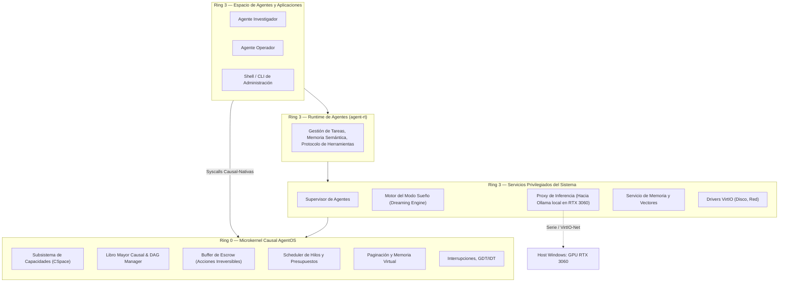
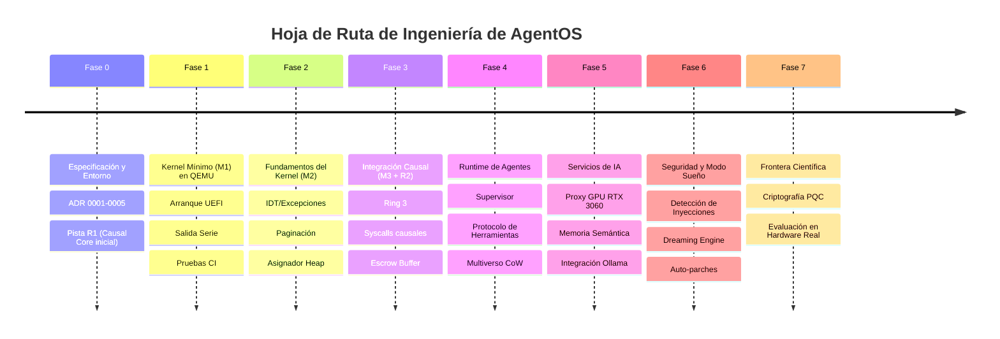

# AgentOS — Documento maestro de arquitectura e investigación

| Campo | Valor |
| :--- | :--- |
| Versión | 0.2 — Núcleo Causal y Multiverso con Escrow |
| Fecha | 2026-10-11 |
| Fase actual | **Fase 0 — Investigación y especificación** |
| Código compilado/ejecutado hasta hoy | **Ninguno.** Este documento es diseño. |

> [!IMPORTANT]
> **Tesis Central de AgentOS:**
> En los sistemas operativos tradicionales de tipo Unix/POSIX, *"todo es un archivo"*.
> En AgentOS, **"toda interacción entre dominios es un efecto causalmente registrado en un grafo acíclico inmutable"**.
> 
> Esta primitiva unifica de forma determinista:
> 1. Control de flujo de información (IFC) contra inyección de prompts.
> 2. Ramas especulativas seguras (*Multiverso*) con retención de efectos irreversibles (*Escrow*).
> 3. Auditoría y trazabilidad matemática con consultas de causa (`why()`).
> 4. Auto-optimización comprobada en tiempo ocioso (*Modo Sueño*).

---

## 1. Resumen ejecutivo

AgentOS es un proyecto de **investigación e ingeniería de sistemas de largo plazo**. Su objetivo es construir un **sistema operativo experimental con kernel propio en Rust (x86-64)** que proporcione soporte nativo de bajo nivel a agentes de inteligencia artificial y cargas de cómputo autónomas.

### Principios Fundamentales del Kernel
1. **El kernel no es probabilístico ni "piensa":** No incorpora modelos de lenguaje dentro de Ring 0. Ofrece mecanismos deterministas, seguros y formalmente verificables: aislamiento por hardware, capacidades delegables, libro mayor causal, colas de escrow y contabilidad de recursos.
2. **La IA es un dispositivo no determinista:** Las respuestas de los modelos de IA se tratan con la misma semántica que los paquetes de red o las interrupciones de hardware: se capturan en el libro mayor como eventos externos, garantizando que el sistema completo sea 100% reproducible y auditable.
3. **Estrategia en Dos Pistas (Dual-Track Engineering):**
   - **Pista K (Kernel Bare-Metal):** Construcción progresiva del kernel en Rust (`x86_64-unknown-none`), arrancando en QEMU mediante UEFI/Limine con salida de diagnóstico por puerto serie.
   - **Pista R (Motor Causal y Multiverso):** Implementación de las estructuras causales, etiquetas de integridad y cola de escrow en librerías modulares `no_std` (`crates/causal-core`), testeables de inmediato en modo host.
   - En la **Fase 3**, la Pista R se enlaza dentro del kernel de la Pista K como el subsistema nativo de IPC y syscalls.

---

## 2. Los Criterios de Aceptación Nativos (N1 - N8)

| ID | Criterio | Mecanismo | Validación |
| :--- | :--- | :--- | :--- |
| **N1** | Sin capacidad no hay acceso. | Tabla de capacidades (CSpace). | Pruebas negativas: llamadas sin token fallan deterministamente. |
| **N2** | Presupuestos infranqueables. | Contabilidad de CPU, RAM e IPC. | Un agente hostil en bucle no degrada el sistema. |
| **N3** | Auditoría causal completa por construcción. | Libro Mayor Causal append-only. | Reconstrucción completa del grafo de dependencias de una sesión. |
| **N4** | Suspensión y reanudación externa. | Control del TCB por el Supervisor. | Congelar y descongelar agentes sin su cooperación. |
| **N5** | Exploración en Multiverso sin efectos colaterales. | Ramas CoW + Buffer de Escrow. | Abortar una rama no deja rastros en la red ni en el disco persistente. |
| **N6** | Resiliencia y auto-recuperación. | Modelo de supervisión (estilo MINIX 3). | Inyección de pánicos en servicios; recuperación en < 100 ms. |
| **N7** | Atribución de inyecciones de prompt (`why`). | Trazado inverso del DAG causal. | Identificación matemática exacta de la entrada hostil. |
| **N8** | Auto-evolución sin regresiones (*Modo Sueño*). | Replay histórico con mutaciones. | Políticas promovidas solo si pasan 100% de tests invariantes. |

---

## 3. Arquitectura del Sistema por Capas

---

## 4. Hipótesis de Investigación Formales

| ID | Hipótesis | Línea Base | Métrica Principal |
| :--- | :--- | :--- | :--- |
| **H1** | Presupuestos multi-recurso en el kernel aíslan mejor que cgroups en Linux. | Linux + cgroups v2 | Variación de latencia de agentes prioritarios bajo ataque DoS. |
| **H2** | Un grafo causal obligatorio otorga auditoría completa con costo < 5% sobre IPC plano. | auditd en Linux | Porcentaje de eventos capturados y latencia por mensaje IPC. |
| **H3** | El Multiverso con Escrow previene 100% de fugas en acciones externas abortadas. | BranchFS (arXiv 2602.08199) | Tasa de efectos colaterales huérfanos al abortar ramas. |
| **H4** | La persistencia ortogonal reduce el tiempo de recuperación de agentes en fallos. | Checkpoints serializados en JSON | Tiempo de restauración de contexto post-crash. |
| **H5** | La memoria semántica opera mejor como servicio con capacidades que en Ring 0. | Implementaciones monolíticas | Superficie de ataque y complejidad ciclomática del kernel. |
| **H6** | Un asesor probabilístico guiado por un supervisor determinista optimiza latencia p99. | CFS / EEVDF | Reducción de latencia de cola sin violaciones de presupuesto. |
| **H7** | El análisis contrafactual automático (`counterfactual`) aísla la causa raíz de inyecciones de prompt con > 95% de precisión. | Análisis estático de prompts / Guardrails | Precisión y tasa de falsos positivos en suites de inyección. |
| **H8** | El Modo Sueño descubre configuraciones heurísticas superiores sin intervención humana. | Ajustes manuales de sysadmin | Ganancia porcentual en throughput de tareas recurrentes. |

---

## 5. Roadmap Actualizado (Dual-Track)

---

## 6. Documentos del Proyecto y Decisiones

* **[MASTER_PLAN.md](file:///E:/Genaro/Desktop/AgentOS/docs/MASTER_PLAN.md)**: Este documento maestro.
* **[SPEC_CAUSAL_KERNEL.md](file:///E:/Genaro/Desktop/AgentOS/docs/SPEC_CAUSAL_KERNEL.md)**: Especificación técnica y matemática del Kernel Causal y Escrow.
* **[BRAINSTORM.md](file:///E:/Genaro/Desktop/AgentOS/research/BRAINSTORM.md)**: Registro exhaustivo de la sesión de ideas de frontera.
* **[STATUS.md](file:///E:/Genaro/Desktop/AgentOS/docs/STATUS.md)**: Registro en vivo del estado del repositorio y próximos pasos.
* **Registro de Decisiones (ADRs):**
  * [ADR-0001: Rust estable y target x86_64-unknown-none](file:///E:/Genaro/Desktop/AgentOS/docs/adr/0001-rust-estable-x86_64-unknown-none.md)
  * [ADR-0002: Arranque UEFI con Limine](file:///E:/Genaro/Desktop/AgentOS/docs/adr/0002-arranque-uefi-limine.md)
  * [ADR-0003: Microkernel por capacidades e IA fuera de Ring 0](file:///E:/Genaro/Desktop/AgentOS/docs/adr/0003-kernel-capacidades-ia-fuera-de-ring0.md)
  * [ADR-0004: Entorno QEMU, salida serie y xtask](file:///E:/Genaro/Desktop/AgentOS/docs/adr/0004-entorno-qemu-serie-xtask.md)
  * [ADR-0005: El Kernel Causal, Multiverso con Escrow y Análisis Contrafactual](file:///E:/Genaro/Desktop/AgentOS/docs/adr/0005-kernel-causal-multiverso-escrow.md)
