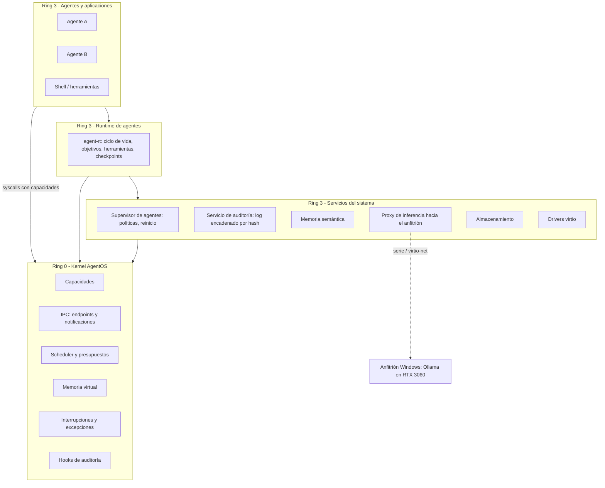
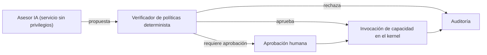
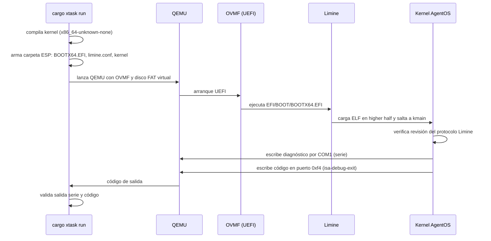

# AgentOS — Documento maestro de arquitectura e investigación

| Campo | Valor |
| :--- | :--- |
| Versión | 0.1 — borrador para revisión |
| Fecha | 2026-10-11 |
| Fase actual | **Fase 0 — Investigación y especificación** |
| Código compilado/ejecutado hasta hoy | **Ninguno.** Este documento es diseño. |

> [!IMPORTANT]
> **Cómo leer este documento.**
> - Distingo **hechos documentados** de **hipótesis propias** (marcadas como **H1, H2, …**).
> - Cada referencia lleva una etiqueta:
>   - **[C]** Trabajo clásico o ampliamente conocido. Lo cito de memoria; la fuente primaria es identificable, pero todavía no la volví a leer para este proyecto.
>   - **[B]** Localizado mediante búsqueda web el 2026-10-11, con identificador concreto (por ejemplo, un ID de arXiv). Leí el resumen, no el texto completo.
>   - **[P]** Lo mencionaron resultados de búsqueda, pero **no verifiqué la fuente primaria**. No se usa para tomar decisiones hasta leerlo.
> - Nada de lo que aparece como "salida esperada" fue observado todavía.

---

## 1. Resumen ejecutivo

AgentOS es un proyecto de **investigación e ingeniería de largo plazo**. Su objetivo es construir un **sistema operativo experimental con kernel propio, escrito en Rust para x86-64**, que trate a los agentes autónomos como entidades administradas por el sistema y no como simples aplicaciones sobre un modelo de procesos POSIX.

**Posición central de este documento (recomendación):**

1. **El kernel no "piensa".** No incluye modelos de lenguaje, no interpreta lenguaje natural y no toma decisiones probabilísticas. Ofrece **mecanismos deterministas, pequeños y verificables**: espacios de direcciones, hilos, capacidades, IPC, presupuestos de recursos y auditoría.
2. **Lo que vuelve a AgentOS "nativo para agentes"** no es tener un LLM adentro. Es que el sistema provee, impone y audita, desde el kernel hacia arriba, cinco cosas que hoy los frameworks de agentes emulan en espacio de usuario sobre Linux:
   - identidad;
   - capacidades (permisos) delegables;
   - presupuestos multi-recurso;
   - ejecución transaccional (probar → confirmar o descartar);
   - persistencia y recuperación.
3. **La inteligencia vive en servicios de usuario**: memoria semántica, proxy de inferencia y asesor de planificación. Estos servicios **proponen**; un mecanismo determinista **dispone**.
4. **Avanzamos por hitos mínimos y verificables.** El primero es concreto: **compilar un kernel propio y arrancarlo en QEMU vía UEFI**, con salida por puerto serie y una prueba automatizada que confirme el arranque.

**Viabilidad, en una línea:** un kernel de investigación que corre en QEMU, con espacio de usuario, IPC, capacidades y un runtime de agentes, es alcanzable en **años** por un fundador con asistencia de IA. Un sistema operativo de propósito general para hardware real —incluyendo tu RTX 3060 con driver nativo— **no lo es** en ese horizonte. La inferencia en GPU se resolverá con un **proxy hacia el anfitrión** (ver §5).

---

## 2. Qué significa que AgentOS sea "nativo para agentes"

### 2.1 Definición operativa

> AgentOS es **nativo para agentes** si un agente es una **entidad reconocida y gobernada por el sistema**: tiene identidad propia, solo puede afectar al mundo mediante **capacidades explícitas**, consume recursos contra **presupuestos impuestos por el sistema**, deja un **registro auditable** de sus acciones con efectos externos y puede ser **suspendido, reanudado, reiniciado o revertido** por el sistema sin su cooperación.

### 2.2 Criterios verificables

Una definición sin pruebas no sirve. Estos criterios se convertirán en tests de aceptación en las Fases 3, 4 y 6.

| ID | Criterio | Cómo se verifica |
| :--- | :--- | :--- |
| **N1** | Un agente no puede acceder a ningún recurso (memoria, archivo, red, herramienta, otro agente) sin una capacidad que lo autorice. | Pruebas negativas: el acceso sin capacidad falla de forma determinista. |
| **N2** | Un agente no puede exceder sus presupuestos de CPU, memoria y tasa de IPC, aunque sea malicioso. | Un agente hostil en bucle infinito o con fuga de memoria no degrada a los demás más allá de un umbral medido. |
| **N3** | Toda invocación de capacidad con efecto externo queda registrada con identidad, capacidad, operación y resultado, en un log a prueba de manipulación. | Reconstruir la traza completa de una tarea a partir del log; detectar alteraciones del log. |
| **N4** | El sistema puede suspender y reanudar un agente sin su cooperación. | Prueba de suspensión y reanudación con verificación de estado. |
| **N5** | Un agente puede ejecutar acciones en un contexto transaccional y confirmar o descartar sus efectos. | Abortar una rama no deja efectos observables. |
| **N6** | La caída de un agente o de un servicio no tumba el sistema, y un supervisor puede reiniciarlo. | Inyección de fallos: matar servicios y medir el tiempo de recuperación. |

### 2.3 Qué **no** significa

- No significa que el kernel ejecute un LLM.
- No significa que el sistema de archivos tradicional desaparezca: la memoria semántica **se agrega**, no reemplaza.
- No significa que una IA pueda obtener privilegios porque "lo propone".
- No significa, por ahora, que el diseño sea novedoso o superior. Eso se demuestra con experimentos (§4.9 y Fase 7).

---

## 3. Kernel, servicios, runtime y aplicaciones

### 3.1 Las cuatro capas

| Capa | Privilegio | Responsabilidad | Ejemplos en AgentOS |
| :--- | :--- | :--- | :--- |
| **Kernel** | Ring 0 (modo supervisor) | Mecanismos mínimos que **requieren** privilegio de hardware. | Paginación, interrupciones, hilos, cambio de contexto, capacidades, IPC, contabilidad de presupuestos. |
| **Servicios privilegiados** | Ring 3, con capacidades poderosas delegadas | Políticas del sistema y drivers. | Supervisor de agentes, servicio de almacenamiento, drivers virtio, servicio de auditoría, registro de nombres. |
| **Runtime de agentes** | Ring 3 (biblioteca más servicio) | Modelo de agente: ciclo de vida, objetivos, herramientas, checkpoints semánticos. | `agent-rt`: estados del agente, protocolo de herramientas, cliente de memoria. |
| **Aplicaciones / agentes** | Ring 3, mínimo privilegio | Lógica concreta. | Agente investigador, agente programador, shell. |

### 3.2 Regla para decidir qué va en el kernel

Seguimos el **principio de minimalidad** de Liedtke **[C]** (*On µ-Kernel Construction*, SOSP 1995). Algo entra al kernel solo si:

1. no se puede implementar de forma segura fuera del kernel, **o**
2. implementarlo fuera impide cumplir un requisito medido de rendimiento, **y además**
3. es **mecanismo, no política**.

### 3.3 Ubicación de cada función de agente

| Función | Kernel | Servicio / runtime | Justificación |
| :--- | :--- | :--- | :--- |
| Identidad | Dominio de protección con identificador (*badge*) inmutable | Metadatos ricos: nombre, dueño, propósito | El kernel necesita una identidad no falsificable para auditar y contabilizar. El resto es política. |
| Permisos | Capacidades: crear, delegar, revocar | Políticas de qué otorgar | Mecanismo clásico de sistemas por capacidades (seL4, EROS). |
| Presupuestos | Imposición de CPU y memoria | Contabilidad de tokens de inferencia, costos y energía | Solo el kernel puede detener un bucle infinito. Los tokens los cuenta el servicio que los consume. |
| Objetivos y tareas | — | Runtime | Son semántica de alto nivel. Congelarlos en ring 0 sería prematuro. |
| Memoria y contexto | Páginas y espacios de direcciones | Servicio de memoria semántica | La recuperación por significado es política y algoritmo, no mecanismo. |
| Comunicación | IPC con endpoints y notificaciones | Protocolo tipado de mensajes entre agentes | El kernel transporta; el runtime da significado. |
| Suspensión y checkpoint | Suspender hilos; captura del espacio de direcciones | Checkpoint semántico | Combinación de mecanismo y política. |
| Auditoría | *Hooks* deterministas en las invocaciones de capacidades | Almacenamiento, encadenamiento hash, consulta | El punto de mediación tiene que ser inevitable; el almacenamiento puede vivir afuera. |
| Modelos de IA | **Nunca** | Servicio de inferencia o proxy al anfitrión | Superficie de ataque enorme, no determinista, sin justificación técnica para ring 0. |

---

## 4. Estado del arte inicial

> [!NOTE]
> Este es un **mapa inicial**, no una revisión sistemática. Una tarea de la Fase 0 es leer las fuentes primarias marcadas como prioritarias y actualizar esta sección. No incluyo cifras de benchmarks: no las verifiqué y no las voy a inventar.

### 4.1 "Sistemas operativos para agentes" (la mayoría corre sobre Linux)

| Trabajo | Problema | Enfoque | Qué reutilizamos | Límite / oportunidad |
| :--- | :--- | :--- | :--- | :--- |
| **AIOS: LLM Agent Operating System**, Mei et al., arXiv 2403.16971 (2024); según búsqueda, publicado en COLM 2025 **[C/B]** | Agentes concurrentes compiten por el LLM, el contexto y las herramientas sin coordinación. | "Kernel" de agentes en espacio de usuario: scheduler de llamadas al LLM, gestor de contexto, memoria, almacenamiento y herramientas. | Taxonomía de servicios. **Es la línea base natural para comparar.** | Es middleware sobre Linux: no hay aislamiento de hardware entre agentes ni imposición en el kernel. |
| **MemGPT: Towards LLMs as Operating Systems**, Packer et al., arXiv 2310.08560 (2023), hoy Letta **[C]** | La ventana de contexto es limitada. | Memoria jerárquica inspirada en la paginación: el LLM mueve información entre contexto y almacenamiento externo. | Analogía de "fallo de página semántico" para el servicio de memoria. | Opera dentro del agente, no como servicio del sistema con control de acceso. |
| **LLM as OS, Agents as Apps**, Ge et al., arXiv 2312.03815 (2023) **[C]** | Visión conceptual. | El LLM como "kernel" y los agentes como aplicaciones. | Vocabulario. | Es una **metáfora**. AgentOS hace lo opuesto: el kernel es determinista. |
| **Fork, Explore, Commit: OS Primitives for Agentic Exploration**, arXiv 2602.08199 (2026) **[B]** | Los agentes exploran varias soluciones en paralelo y dejan efectos colaterales. | *Branch contexts* con sistema de archivos copy-on-write (BranchFS sobre FUSE) y una syscall `branch()` propuesta para Linux; el primer commit gana. | **Evidencia directa a favor de H3.** Línea base para comparar. | Es una adaptación a Linux. En un sistema por capacidades, la rama podría contener *todos* los efectos, no solo los de archivos. |
| **MemOS**, **KAOS**, *Toward Securing AI Agents Like Operating Systems* (2025–2026) **[P]** | Memoria, sistemas multi-agente y seguridad de agentes. | Aparecieron en búsquedas. | Pendiente. | **Leer antes de afirmar nada.** |
| **Model Context Protocol (MCP)**, Anthropic, 2024; **A2A**, Google, 2025 **[C]** | Interfaz estándar agente↔herramienta y agente↔agente. | Protocolos JSON-RPC. | Referencia para el protocolo de herramientas del runtime (Fase 4). | Son protocolos de aplicación; no imponen aislamiento. |

**Conclusión provisional (hipótesis, no hecho):** la mayor parte del trabajo de "agent OS" son **runtimes en espacio de usuario sobre Linux**, más algunas primitivas sueltas propuestas *para* Linux. Un kernel diseñado desde cero alrededor de capacidades, presupuestos, transacciones y persistencia **para agentes** parece menos explorado. **No lo afirmo como novedad hasta completar la revisión** (tarea F0-3).

### 4.2 Kernels experimentales y en Rust

| Trabajo | Aporte relevante | Qué tomamos |
| :--- | :--- | :--- |
| **seL4**, Klein et al., SOSP 2009 **[C]** | Microkernel por capacidades, con verificación formal de corrección funcional. | **Modelo de objetos de referencia** (Untyped, CNode, TCB, Endpoint, Notification) y su manual como guía de diseño. |
| **seL4 MCS**, Lyons et al., EuroSys 2018 (*Scheduling-context capabilities*) **[C]** | El tiempo de CPU es un objeto delegable mediante capacidades. | **Base directa para los presupuestos de H1.** |
| **Theseus**, Boos et al., OSDI 2020 **[C]** | Kernel en Rust que aprovecha el lenguaje para gestionar el estado y permitir evolución en vivo. | Ideas de modularidad y de manejo del estado. |
| **RedLeaf**, Narayanan et al., OSDI 2020 **[C]** | Aislamiento por lenguaje en Rust, sin cambiar de espacio de direcciones. | Tomado como alternativa y descartado como mecanismo principal (§6.4). |
| **Redox OS** **[C]** | Microkernel en Rust, tipo Unix, con escritorio. | Referencia práctica de drivers en espacio de usuario. |
| **Hubris** (Oxide) y **Tock**, Levy et al., SOSP 2017 **[C]** | Kernels en Rust para sistemas embebidos, centrados en aislamiento y robustez. | Patrones de tareas aisladas y supervisión. |
| **Asterinas**, USENIX ATC 2025 **[C]** | "Framekernel" en Rust compatible con la ABI de Linux, que limita el `unsafe` a una base pequeña. | **Disciplina de minimizar `unsafe`.** |
| **Fuchsia / Zircon** (Google) **[C]** | Kernel por capacidades (*handles*) en producción. | Diseño de *handles*, VMOs y *jobs* como jerarquía de recursos. |
| **MINIX 3**, Herder et al., 2006 **[C]** | El *reincarnation server* reinicia drivers caídos. | **Base para N6** (supervisión y autorreparación). |
| **Microreboot**, Candea et al., OSDI 2004 **[C]** | Reiniciar componentes pequeños en lugar del sistema entero. | Estrategia de recuperación. |
| **Singularity**, Hunt y Larus, 2007 **[C]** | Procesos aislados por software con canales tipados. | IPC tipado y contratos. |
| **Barrelfish** (Multikernel), Baumann et al., SOSP 2009 **[C]** | El sistema operativo como sistema distribuido entre núcleos y aceleradores. | Visión para la computación heterogénea (Fase 7). |

### 4.3 Seguridad por capacidades

| Trabajo | Qué tomamos |
| :--- | :--- |
| **KeyKOS / EROS**, Shapiro et al., SOSP 1999 **[C]** | Capacidades más **persistencia ortogonal** (checkpoint de todo el sistema). Base para H4. |
| **Capsicum**, Watson et al., USENIX Security 2010 **[C]** | Capacidades dentro de un sistema Unix. Útil para comparar. |
| **CHERI**, Watson et al. **[C]** | Capacidades en hardware. Fuera de alcance (no está en x86-64), pero sirve de referencia conceptual. |

### 4.4 Planificación de recursos

| Trabajo | Qué tomamos |
| :--- | :--- |
| Linux **CFS → EEVDF** (Linux 6.6) y **sched_ext** (planificadores en BPF, Linux 6.12) **[C]** | Línea base para comparar. Muestra que el planificador puede ser extensible sin comprometer la seguridad. |
| **Decima**, Mao et al., SIGCOMM 2019 **[C]** | Aprendizaje por refuerzo para planificar trabajos en clústeres. Muestra el patrón "un modelo propone". |
| **Gandiva**, OSDI 2018; **PTask**, Rossbach et al., SOSP 2011 **[C]** | La GPU como recurso gestionado por el sistema. |
| **vLLM / PagedAttention**, Kwon et al., SOSP 2023 **[C]** | Ideas de paginación aplicadas a la caché KV. Muestra que las abstracciones de SO sirven para inferencia. |

### 4.5 Memoria semántica y almacenamiento

| Trabajo | Qué tomamos |
| :--- | :--- |
| **Semantic File Systems**, Gifford et al., SOSP 1991 **[C]** | La idea de acceder a archivos por atributos tiene más de 30 años. **No la presentamos como nueva.** |
| MemGPT, AIOS, LSFS (*LLM-based Semantic File System*, 2024) **[P]** | Recuperación de contexto para agentes. |

### 4.6 Seguridad de agentes autónomos

| Trabajo | Qué tomamos |
| :--- | :--- |
| **Indirect Prompt Injection**, Greshake et al., AISec 2023 **[C]** | Amenaza central: datos externos que se convierten en instrucciones. **Por eso la IA nunca decide privilegios.** |
| **CaMeL: Defeating Prompt Injections by Design**, Debenedetti et al., arXiv 2503.18813 (2025) **[C]** | Separación entre flujo de control y datos, con capacidades, a nivel de aplicación. AgentOS podría imponer algo análogo a nivel de sistema. |
| **DARPA Cyber Grand Challenge** (2016) y **AIxCC** (2023–2025) **[C]** | Detección y parcheo automático existen, con límites. Base realista para la Fase 6. |

### 4.7 Criptografía poscuántica, ZKP y simulación cuántica

| Tema | Estado documentado | Uso en AgentOS |
| :--- | :--- | :--- |
| PQC | NIST publicó **FIPS 203 (ML-KEM)**, **FIPS 204 (ML-DSA)** y **FIPS 205 (SLH-DSA)** en agosto de 2024 **[C]**. | Firmas de actualizaciones y arranque verificado (Fase 6/7), **con bibliotecas existentes** (por ejemplo, Open Quantum Safe / liboqs o crates de RustCrypto). Sin criptografía propia. |
| ZKP | Groth16 (2016), PLONK (2019), zkVMs como RISC Zero **[C]**. | Investigación: pruebas verificables sobre logs de auditoría *sin revelarlos*. Para detectar manipulación alcanzan cadenas hash y árboles de Merkle; ZKP solo se justifica si hace falta **privacidad**. |
| Simulación cuántica | Qiskit Aer, NVIDIA cuQuantum **[C]**. | **Es una aplicación, no una función del SO.** Prioridad baja; ver §5. |

### 4.8 Herramientas de desarrollo existentes

| Recurso | Uso |
| :--- | :--- |
| *Writing an OS in Rust*, Philipp Oppermann (os.phil-opp.com) **[C]** | Material didáctico principal para las Fases 1 y 2. |
| OSDev Wiki, *Intel SDM*, *OSTEP* (Arpaci-Dusseau, libro gratuito) **[C]** | Teoría y referencia de hardware. |
| Crates `x86_64`, `limine`, `uart_16550`, `spin`, `smoltcp` **[C]** | Componentes maduros, para no reinventar. |
| **Limine** (bootloader) **[B]** | Según búsqueda, la última versión estable es v12.x (octubre de 2026). **La versión exacta se fija en M1.** |

### 4.9 Hipótesis de investigación que se desprenden

| ID | Hipótesis | Línea base | Métrica principal |
| :--- | :--- | :--- | :--- |
| **H1** | Presupuestos multi-recurso jerárquicos y delegables mediante capacidades (al estilo seL4 MCS, extendidos a memoria, IPC y dispositivos) aíslan mejor a agentes hostiles que cgroups más un runtime en espacio de usuario. | Linux + cgroups v2 + AIOS | Degradación de los agentes "víctima" con un agente hostil presente; sobrecarga de la contabilidad. |
| **H2** | Si todo efecto externo pasa por una invocación de capacidad, se obtiene una **auditoría completa por construcción**, con un costo aceptable. | Auditoría en el runtime (Linux + auditd + logs) | Cobertura de la auditoría (% de efectos registrados); costo por invocación. |
| **H3** | Contextos transaccionales nativos (espacio de direcciones copy-on-write + almacenamiento ramificado + efectos retenidos hasta el commit) son más baratos y completos que los equivalentes en Linux. | arXiv 2602.08199 (BranchFS / `branch()`), contenedores, snapshots | Latencia de fork y commit; fugas de efectos al abortar. |
| **H4** | La persistencia ortogonal al estilo EROS reduce el tiempo de recuperación de agentes de larga duración. | Checkpoint en el runtime (serialización) | Tiempo de recuperación; pérdida de estado. |
| **H5** | La memoria semántica funciona mejor como **servicio** con acceso por capacidades que como primitiva del kernel. | — (es una decisión de diseño a validar) | Latencia, aislamiento, complejidad del kernel. |
| **H6** | Un asesor aprendido que **propone** decisiones de planificación, con un mecanismo determinista que las impone, mejora la latencia de cola sin romper garantías. | EEVDF / round-robin con prioridades | Latencia p99; violaciones de presupuesto (deben ser 0). |

---

## 5. Evaluación crítica de la viabilidad

| Componente | Viabilidad | Comentario honesto |
| :--- | :--- | :--- |
| Kernel que arranca en QEMU (Fase 1) | **Alta** | Camino muy transitado en Rust. Semanas, no meses. |
| Memoria, interrupciones y scheduler básico (Fase 2) | **Alta / media** | La dificultad es conceptual, no de volumen. |
| Espacio de usuario, syscalls, capacidades e IPC (Fase 3) | **Media** | Primer gran salto. Acá se decide si el diseño es sólido. |
| Runtime de agentes en espacio de usuario (Fase 4) | **Media** | Exige portar o escribir bibliotecas `no_std` / un `std` mínimo. |
| Arranque en tu PC real | **Media**, a futuro | UEFI ayuda. Los drivers de disco NVMe y de red son trabajo extra. |
| **Driver nativo para la RTX 3060** | **Muy baja** | NVIDIA depende de firmware (GSP) y de pilas enormes pensadas para Linux. **Recomendación: no intentarlo.** |
| Inferencia de IA desde AgentOS | **Media**, con proxy | AgentOS (en QEMU) habla con un servicio en Windows (por ejemplo, Ollama en tu RTX 3060). Primero por un puerto serie conectado a TCP; después por red virtio con `smoltcp`. **Sigue siendo local y sin Internet.** |
| Inferencia por CPU *dentro* de AgentOS | **Baja / media** | Requiere un `std`, hilos y SIMD propios. Posible a largo plazo con modelos pequeños. |
| Seguridad avanzada (Fase 6) | **Media** | La auditoría y la contención son viables. La "autorreparación" completa es un **problema abierto**: no se promete. |
| PQC para firmas | **Alta**, si se usan bibliotecas existentes | Implementar algoritmos propios queda descartado para producción. |
| ZKP aplicadas | **Baja / media** | Costosas y especializadas. Solo con una hipótesis concreta. |
| Simulación cuántica | **Alta como aplicación**, irrelevante para el kernel | Puede correr en Windows hoy. Integrarla a AgentOS solo tiene sentido como aplicación de ejemplo. |

**Riesgo principal:** no es técnico, es de **alcance y curva de aprendizaje**. El fracaso típico de los proyectos de SO aficionados es intentar todo a la vez. La mitigación es este roadmap: hitos chicos, pruebas automáticas y criterios explícitos para detenerse.

**Horizonte orientativo**, suponiendo unas 10–15 horas por semana: Fases 0 a 3 en **12–24 meses**; un runtime de agentes funcional en **2–3 años**. Son estimaciones condicionales, no promesas.

---

## 6. Arquitectura propuesta y alternativas

### 6.1 Vista general



### 6.2 Objetos del kernel (objetivo de la Fase 3, inspirados en seL4)

| Objeto | Función |
| :--- | :--- |
| `Frame` / `Untyped` | Memoria física asignable. |
| `AddressSpace` | Tablas de páginas de un dominio. |
| `Thread` | Contexto de ejecución. |
| `Budget` | Presupuesto de CPU, memoria y tasa de IPC (extensión de las *scheduling contexts* de seL4 MCS). |
| `Endpoint` / `Notification` | IPC síncrono y señales asíncronas. |
| `CSpace` | Tabla de capacidades de un dominio. |
| `Domain` | Agrupa CSpace, AddressSpace, Threads y Budget bajo una identidad inmutable. **Un agente es un Domain administrado por el Supervisor.** |

### 6.3 Dilema clave: ¿el kernel conoce el concepto de "Agente"?

| Opción | A favor | En contra |
| :--- | :--- | :--- |
| **A. Objeto `Agent` en el kernel** (con objetivos, estado y presupuesto) | Narrativa más "nativa". | Congela en ring 0 una abstracción que todavía no entendemos. Viola la minimalidad. Es difícil de cambiar. |
| **B. El kernel ofrece `Domain` + `Budget` + capacidades + auditoría; el Supervisor define qué es un agente** ✅ | Mecanismo genérico y verificable. La semántica evoluciona sin tocar ring 0. Permite comparar de forma justa. | La "nativeza" depende de que el Supervisor sea inevitable (lo garantizan las capacidades). |

**Recomendación: B.** Promoveríamos algo al kernel solo si un experimento demuestra que hace falta. Por ejemplo, si el scheduler necesitara plazos de objetivos para cumplir H6.

### 6.4 Alternativas de estructura del kernel

| Alternativa | Decisión | Razón |
| :--- | :--- | :--- |
| Monolítico tipo Linux | Descartada como objetivo final | Drivers y servicios en ring 0: un fallo tumba todo y contradice el mínimo privilegio. |
| Microkernel puro desde el día 1 | Descartada como *punto de partida* | Demasiada complejidad simultánea para alguien que recién empieza. |
| **Híbrido evolutivo** ✅ | **Recomendada** | Fases 1–2: un solo binario en ring 0 con límites de módulo limpios. Fase 3: espacio de usuario y capacidades. Después, drivers y servicios migran a ring 3 uno por uno. |
| Unikernel | Descartada | Una sola aplicación y sin aislamiento entre agentes. |
| Aislamiento solo por lenguaje (estilo RedLeaf/Theseus) | Descartada como mecanismo principal | Los agentes ejecutarán código no confiable o generado por IA; el aislamiento por hardware es imprescindible. Se reevalúa como complemento. |
| Construir sobre seL4 | Descartada por requisito; **es la referencia de diseño** | Sería lo más pragmático para un laboratorio, pero el objetivo es un kernel propio. Usamos su API como guía. |
| Linux + capa de agentes | Descartada por requisito; **es la línea base experimental** | AIOS sobre Linux es contra lo que vamos a comparar. |

### 6.5 Arranque: alternativas

| Opción | Decisión | Razón |
| :--- | :--- | :--- |
| **Limine (UEFI) + kernel ELF en el target `x86_64-unknown-none`** ✅ | **Recomendada** | Funciona con Rust **estable**. Entrega el mapa de memoria, el *higher-half direct map*, framebuffer y SMP. En Windows no hace falta armar una ISO: QEMU puede montar una carpeta como disco FAT (`fat:rw:`). El bootloader es una **herramienta reemplazable, no parte del kernel**. |
| Crate `bootloader` (rust-osdev) | Alternativa de respaldo | 100 % Rust, pero su versión 0.11 depende de una función inestable de cargo (`bindeps`), lo que exige nightly. |
| Bootloader UEFI propio (`uefi-rs`) | Postergada a la Fase 6 | Valioso para el **arranque verificado**, pero no aporta nada al primer hito. |
| GRUB + Multiboot2 | Descartada | Herramientas incómodas en Windows y requiere la transición de 32 a 64 bits en ensamblador. |

### 6.6 Principio de seguridad: "la IA propone, el mecanismo dispone"



Una propuesta de IA **nunca** es, en sí misma, una autorización.

---

## 7. Roadmap

> Los plazos son orientativos (unas 10–15 h/semana). Cada fase puede revisarse, reordenarse o descartarse si la evidencia lo indica.

### Fase 0 — Investigación y especificación *(1–3 semanas, en curso)*
- **Objetivo:** alcance, decisiones iniciales y entorno listo.
- **Prerrequisitos:** ninguno.
- **Entregables:** este documento, los ADR 0001–0004, el entorno instalado (M1.0) y la revisión de las fuentes [P] y de las prioritarias.
- **Tareas:**
  - F0-1: instalar las herramientas.
  - F0-2: leer AIOS, arXiv 2602.08199, el manual de seL4 (capítulos de capacidades y MCS) y Oppermann (posts 1–4).
  - F0-3: búsqueda sistemática de "kernel nativo para agentes" en arXiv, OSDI, SOSP, EuroSys y ATC (2023–2026).
- **Aceptación:** ADR aprobados por el fundador; `rustc`, `cargo` y `qemu-system-x86_64` responden; tabla §4.1 actualizada.
- **Riesgos:** parálisis por análisis. **Límite: 3 semanas.**
- **Revisar si:** F0-3 encuentra un kernel que ya implementa H1–H4. En ese caso, reorientar hacia lo no cubierto.

### Fase 1 — Kernel mínimo *(2–6 semanas)*
- **Objetivo:** un kernel propio que arranca en QEMU vía UEFI y reporta por puerto serie. Detalle en §10.
- **Subsistemas:** arranque (Limine), salida serie, *panic handler* y una prueba de arranque automatizada.
- **Módulos:** `kernel/src/main.rs`, `serial.rs`, `panic.rs`, `qemu_exit.rs`, `linker-x86_64.ld`, `xtask/`.
- **Herramientas:** Rust estable, QEMU, OVMF y Limine.
- **Aceptación:** ver §10.6.
- **Riesgos:** configuración del linker o de la carga en *higher half*; firmware OVMF.
- **Avanzar si:** `cargo xtask test` pasa 10 veces seguidas.
- **Revisar si:** tras 6 semanas no arranca. En ese caso, cambiar al crate `bootloader` (ADR nuevo).

### Fase 2 — Fundamentos del kernel *(2–4 meses)*
- **Objetivo:** el kernel controla la CPU y la memoria.
- **Subsistemas:**
  - GDT/TSS e IDT;
  - excepciones (page fault, double fault con pila IST);
  - APIC y temporizador;
  - asignador de marcos físicos;
  - paginación propia y *heap* del kernel (`alloc`);
  - hilos del kernel y scheduler round-robin;
  - spinlocks y primitivas de concurrencia.
- **Módulos:** `arch/x86_64/{gdt,idt,apic}.rs`, `mm/{frame,paging,heap}.rs`, `sched/`, `sync/`.
- **Aceptación:**
  - un acceso inválido produce un page fault reportado (no un *triple fault*);
  - `Vec`/`Box` funcionan en el kernel;
  - dos hilos del kernel se alternan por interrupción del temporizador;
  - pruebas en QEMU para cada punto.
- **Riesgos:** *triple faults* silenciosos (mitigación: `-d int`, gdb), *deadlocks* en interrupciones.
- **Revisar si:** el asignador o el scheduler acumulan errores de memoria. Detenerse, agregar pruebas y simplificar.

### Fase 3 — Servicios del sistema *(4–8 meses)*
- **Objetivo:** espacio de usuario aislado con capacidades e IPC.
- **Subsistemas:**
  - ring 3 y syscalls (`syscall`/`sysret`);
  - carga de programas ELF de usuario;
  - objetos del kernel (§6.2) y CSpace;
  - IPC con endpoints;
  - primer servicio en espacio de usuario (driver serie o *ramdisk*);
  - presupuesto de CPU.
- **Módulos:** `kernel/src/{syscall,cap,ipc,object}/`, `crates/abi/` (ABI compartida), `services/init/`.
- **Aceptación:**
  - un proceso de usuario no puede leer memoria del kernel ni de otro proceso (prueba negativa);
  - sin capacidad no hay acceso (N1);
  - un bucle infinito en espacio de usuario no congela el sistema (N2 parcial).
- **Riesgos:** diseño de la ABI de capacidades (difícil de cambiar después). **Escribir ADR y modelo de amenazas antes de codificar.**
- **Revisar si:** el modelo de capacidades resulta inmanejable. Comparar con el de seL4 y simplificar.

### Fase 4 — Runtime de agentes *(3–6 meses)*
- **Objetivo:** agentes como Domains gestionados.
- **Subsistemas:**
  - Supervisor (crear, suspender, reanudar, matar, reiniciar);
  - `agent-rt`;
  - protocolo de herramientas (inspirado en MCP);
  - mensajería tipada entre agentes;
  - presupuestos jerárquicos (H1);
  - auditoría básica (N3).
- **Aceptación:** N1–N4 y N6 con pruebas automatizadas; demostración con 3 agentes cooperando y uno hostil contenido.
- **Riesgos:** falta de `std`. Decidir entre un `std` mínimo propio y WASM (wasmi) como entorno de ejecución.

### Fase 5 — Servicios de IA *(4–8 meses)*
- **Objetivo:** contexto, memoria semántica e inferencia vía el anfitrión.
- **Subsistemas:**
  - proxy de inferencia (puerto serie conectado a TCP → Ollama en Windows; después virtio-net + `smoltcp`);
  - servicio de memoria semántica con control de acceso por capacidades y registro de procedencia (H5);
  - asesor de planificación que solo propone (H6).
- **Aceptación:** un agente en AgentOS completa una tarea usando un modelo local del anfitrión, sin Internet; el log de auditoría reconstruye la tarea completa.

### Fase 6 — Seguridad avanzada *(continua)*
- **Subsistemas:**
  - modelo de amenazas formal;
  - auditoría a prueba de manipulación (cadena hash / Merkle);
  - detección de anomalías por agente;
  - contención automática dentro de la política;
  - actualizaciones firmadas (con PQC mediante bibliotecas existentes);
  - arranque verificado (bootloader UEFI propio);
  - *fuzzing* de syscalls.
- **Aceptación:** un conjunto reproducible de ataques (escape de sandbox, agotamiento de recursos, inyección de prompt hacia herramientas) contenido y registrado.

### Fase 7 — Investigación avanzada *(abierta)*
- Contextos transaccionales nativos (H3), persistencia ortogonal (H4), planificación heterogénea, ZKP para auditoría privada y simulación cuántica como aplicación.
- **Cada tema exige:** hipótesis, línea base, métricas, experimento reproducible y análisis de resultados negativos (§10 del prompt maestro).

---

## 8. Estructura mínima del repositorio (para el hito M1)

Solo creamos lo que el primer hito necesita. Los directorios `crates/`, `services/`, `agents/` y `tests/` aparecerán cuando una fase los requiera.

```text
AgentOS/
├── README.md                 # Qué es, cómo compilar y correr
├── Cargo.toml                # Workspace: kernel + xtask (default-members = xtask)
├── rust-toolchain.toml       # Versión de Rust fijada + target x86_64-unknown-none
├── .cargo/config.toml        # Alias: `cargo xtask ...`
├── .gitignore
├── kernel/                   # El kernel (no_std, no_main)
│   ├── Cargo.toml
│   ├── build.rs              # Pasa el linker script al enlazador
│   ├── linker-x86_64.ld      # Carga en higher half para Limine
│   └── src/
│       ├── main.rs           # Punto de entrada kmain
│       ├── serial.rs         # Driver UART 16550 (COM1)
│       ├── panic.rs          # Panic → serie → salida de QEMU con error
│       └── qemu_exit.rs      # Dispositivo isa-debug-exit para pruebas
├── boot/
│   └── limine.conf           # Configuración del bootloader
├── xtask/                    # Herramienta de build/run/test en Rust (multiplataforma)
│   ├── Cargo.toml
│   └── src/main.rs           # build | run | test | fetch-limine
└── docs/
    ├── MASTER_PLAN.md        # Este documento
    ├── STATUS.md             # Estado actual y próximo paso
    └── adr/                  # Registro de decisiones arquitectónicas
```

**Documentación:** por ahora este documento maestro concentra la visión, la arquitectura, el roadmap, los riesgos y la bibliografía, para no tener dos fuentes de verdad. Cuando se apruebe, se dividirá en `VISION.md`, `ARCHITECTURE.md`, `ROADMAP.md`, `RISKS.md`, `TESTING.md` y `research/STATE_OF_THE_ART.md`.

**Por qué `xtask` y no scripts de PowerShell:** es Rust, funciona igual en Windows y en Linux (útil para CI), se puede probar y deja todo el flujo en un solo lenguaje.

**Binarios de Limine:** `xtask fetch-limine` los descarga en una versión fijada, **verifica el SHA-256** y los deja en `target/` (fuera de git).

---

## 9. Herramientas necesarias (Windows + QEMU)

**Estado verificado del equipo (2026-10-11):**

| Herramienta | Estado |
| :--- | :--- |
| Git 2.50 | ✅ instalado |
| Python 3.12 | ✅ instalado |
| Virtualización por hipervisor | ✅ activa |
| Rust (`rustup`, `cargo`) | ❌ **no instalado** |
| QEMU | ❌ **no instalado** |
| gdb | ❌ no instalado (opcional hasta la Fase 2) |

**Instalación propuesta (M1.0)** — *pendiente; no la ejecuté*:

```powershell
# 1. Rust (rustup). Necesita las Build Tools de MSVC; tenés Visual Studio instalado,
#    se verificará que incluya el workload de C++ (link.exe).
winget install Rustlang.Rustup
rustup default stable
rustup target add x86_64-unknown-none
rustup component add rust-src llvm-tools

# 2. QEMU para Windows (incluye el firmware UEFI OVMF: share\edk2-x86_64-code.fd)
winget install SoftwareFreedomConservancy.QEMU
#    Agregar "C:\Program Files\qemu" al PATH.

# 3. Verificación
rustc --version; cargo --version; qemu-system-x86_64 --version
```

**Notas:**

- **Espacio en disco:** rustup ocupa unos 1,5–2 GB en `C:` (el SSD, que tiene unos 61 GB libres). Conviene dejarlo en el SSD para que compile rápido. El proyecto vive en `E:` (HDD): funciona, aunque las compilaciones serán algo más lentas. Si molesta, se puede mover `target/` al SSD.
- **Aceleración:** para las pruebas usaremos **TCG** (emulación pura): es determinista y depura mejor. WHPX (`-accel whpx`) queda como opción para cuando importe el rendimiento.
- **Editor:** VS Code + rust-analyzer (ya tenés VS Code).
- **Opcional (Fase 2):** gdb vía MSYS2, para conectarse a QEMU con `-s -S`.

---

## 10. Primer hito ejecutable — M1: "AgentOS arranca"

### 10.1 Objetivo
Compilar un kernel propio en Rust (`no_std`), arrancarlo en QEMU con firmware UEFI y el bootloader Limine, imprimir información de diagnóstico por puerto serie y **verificar todo con una prueba automática**.

### 10.2 Por qué este hito
Demuestra la cadena completa *código → binario → firmware → bootloader → kernel → salida observable*. Además, deja la infraestructura de pruebas que usaremos durante años.

### 10.3 Flujo de arranque



### 10.4 Sub-hitos (cada uno verificable por separado)

| Sub-hito | Resultado verificable |
| :--- | :--- |
| **M1.0** | Herramientas instaladas; las tres versiones se imprimen. |
| **M1.1** | `kernel` compila a un ELF x86-64 (comprobado con `llvm-readobj`: punto de entrada en *higher half*). |
| **M1.2** | QEMU arranca y por la consola serie aparece `[AgentOS] kernel iniciado`. |
| **M1.3** | El kernel lee las respuestas de Limine (revisión del protocolo, offset del HHDM, mapa de memoria) y las imprime. |
| **M1.4** | `cargo xtask test` corre QEMU sin ventana, valida la salida y el código de salida, y falla correctamente si el kernel entra en pánico (prueba negativa). |

### 10.5 Salida esperada (hipotética, no observada)

```text
[AgentOS] kernel 0.1.0 iniciado
[AgentOS] protocolo Limine: revision soportada
[AgentOS] HHDM offset: 0xffff8000_00000000
[AgentOS] mapa de memoria: N entradas, ~X MiB utilizables
[AgentOS] M1 OK
```

### 10.6 Criterios de aceptación de M1
1. `cargo xtask run` arranca el kernel en QEMU y muestra la salida anterior (con valores reales).
2. `cargo xtask test` termina con código 0 si el kernel reporta éxito, y con un código distinto de 0 si:
   - el kernel entra en pánico (se prueba con una *feature* `test-panic`), **o**
   - se agota el tiempo (30 s), **o**
   - falta la línea `M1 OK`.
3. La prueba pasa 10 ejecuciones seguidas.
4. La versión de Limine está fijada y su SHA-256 verificado.
5. `docs/STATUS.md` está actualizado con la evidencia (salida real copiada).

### 10.7 Comando QEMU previsto (a verificar en M1.2)

```powershell
qemu-system-x86_64 -machine q35 -m 256M `
  -drive if=pflash,format=raw,readonly=on,file="C:\Program Files\qemu\share\edk2-x86_64-code.fd" `
  -drive format=raw,file=fat:rw:target\esp `
  -serial stdio -display none -no-reboot `
  -device isa-debug-exit,iobase=0xf4,iosize=0x04
```

### 10.8 Detalles que se confirmarán durante la implementación
- Sintaxis exacta de `limine.conf` en la versión fijada (cambió entre versiones mayores).
- Modelo de reubicación del kernel (`static` vs. PIE) y base del linker script.
- Versión del crate `limine` compatible con la versión del bootloader.
- Si el workspace necesita `default-members` para que `cargo build` en la raíz no intente compilar el kernel para Windows.

---

## 11. Riesgos, dependencias y conocimientos a adquirir

### 11.1 Riesgos

| Riesgo | Prob. | Impacto | Mitigación |
| :--- | :--- | :--- | :--- |
| Alcance desbordado | Alta | Alto | Hitos mínimos y criterios para detenerse. |
| Curva de aprendizaje (bajo nivel) | Alta | Medio | Plan de estudio ligado a cada hito (§11.3). |
| Código de IA incorrecto pero plausible en zonas `unsafe` | Media | Alto | Pruebas en QEMU, revisión de cada bloque `unsafe` con un comentario `SAFETY:` justificado, y ningún "funciona" sin evidencia. |
| Diseño de la ABI de capacidades difícil de cambiar | Media | Alto | ADR y prototipo antes de la Fase 3, tomando seL4 como referencia. |
| Dependencia de Limine / crates externos | Baja | Medio | Versiones fijadas; el bootloader es reemplazable (§6.5). |
| Confundir demostración con evidencia | Media | Alto | Métricas y líneas base definidas antes de cada experimento. |
| Afirmar novedad sin sustento | Media | Alto | Tarea F0-3 y revisión periódica de la literatura. |

### 11.2 Dependencias externas
- **Herramientas de desarrollo (no forman parte del sistema final):** Rust/LLVM, QEMU, OVMF, Git y Ollama (anfitrión, Fase 5).
- **Componentes del sistema final (revisables):** Limine (reemplazable), crates `no_std` (`x86_64`, `spin`, `uart_16550`, `limine`, y luego `smoltcp`) y bibliotecas PQC auditadas.

### 11.3 Conocimientos que vas a necesitar, por fase

| Fase | Qué aprender | Recurso |
| :--- | :--- | :--- |
| 0–1 | Rust: ownership, `unsafe`, `no_std`, cargo workspaces. Qué es un bootloader, UEFI, ELF y un linker script. | *The Rust Book*; Oppermann posts 1–3; OSDev Wiki (Limine) |
| 2 | Arquitectura x86-64: registros, anillos de privilegio, paginación de 4 niveles, GDT/IDT/TSS, interrupciones y APIC. Concurrencia: atómicos y spinlocks. | Oppermann posts 4–10; *Intel SDM* vol. 3 (consulta); *OSTEP* (memoria y concurrencia) |
| 3 | Syscalls, procesos, IPC, capacidades. | Manual de seL4; *OSTEP*; papers de seL4 y EROS |
| 4–5 | Sistemas distribuidos básicos, protocolos, redes TCP/IP. | Documentación de `smoltcp`; especificación de MCP |
| 6 | Modelado de amenazas, criptografía aplicada (sin implementarla), *fuzzing*. | NIST FIPS 203/204/205; documentación de liboqs |

---

## 12. Preguntas técnicas abiertas

1. **¿Existe ya un kernel (no middleware) diseñado para agentes con capacidades y presupuestos?** → Tarea F0-3.
2. ¿El Supervisor de agentes debe ser un único proceso o estar distribuido? ¿Qué pasa si cae? (¿Supervisor de supervisores?)
3. ¿Qué entorno de ejecución usan los agentes: binarios nativos con un `std` mínimo propio, WASM (wasmi) o ambos?
4. ¿Cómo se contabilizan recursos que el kernel no ve directamente (tokens de inferencia, energía)? ¿Se puede confiar en los servicios que los reportan?
5. ¿La auditoría debe ser síncrona (bloquea la acción hasta registrarla) o asíncrona con garantías? ¿Cuál es el costo aceptable?
6. Contextos transaccionales (H3): ¿qué hacer con efectos irreversibles (enviar un mensaje de red)? ¿Retenerlos hasta el commit? ¿Con qué semántica?
7. Persistencia (H4): ¿checkpoint de todo el sistema (estilo EROS) o por agente? ¿Cómo interactúa con las capacidades hacia el exterior?
8. ¿Un solo núcleo hasta la Fase 3, o SMP desde la Fase 2? (Recomendación provisional: un solo núcleo hasta la Fase 3.)
9. ¿Qué formato de almacenamiento persistente: sistema de archivos propio, uno existente (FAT para interoperar) o un almacén de objetos?
10. ¿Cuándo intentar el arranque en hardware real y con qué salida de diagnóstico, si no hay puerto serie físico?
11. ¿Licencia del proyecto (MIT/Apache-2.0 como el ecosistema Rust, o GPL)? Afecta qué código externo se puede incorporar.
12. ¿Cómo se integra la verificación formal (por ejemplo, Kani o Verus para Rust) y desde qué fase?

---

## Apéndice A — Próximos pasos inmediatos

1. **Vos:** revisar este documento y aprobar o corregir los ADR 0001–0004 (`docs/adr/`).
2. **M1.0:** instalar Rust y QEMU (con tu autorización explícita, porque modifica el sistema).
3. **M1.1–M1.4:** implementar el kernel mínimo, un sub-hito por iteración, con evidencia real en `docs/STATUS.md`.
