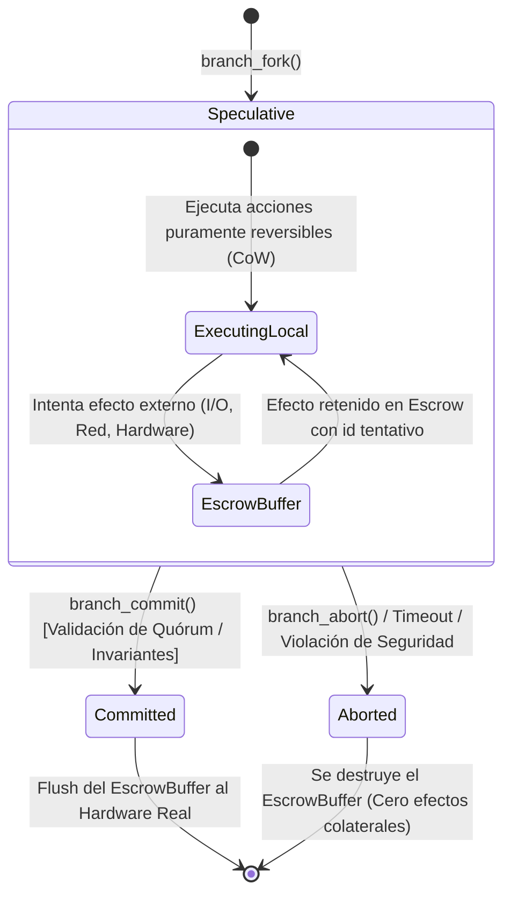
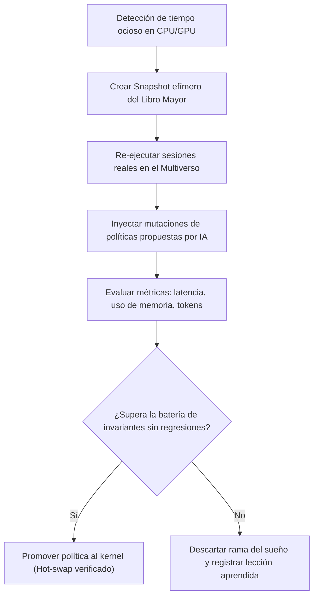

# AgentOS: Especificación Técnica del Kernel Causal (v0.1)

Esta especificación describe la arquitectura formal, las estructuras de datos fundamentales y la semántica matemática del **Kernel Causal** para AgentOS.

---

## 1. Modelo Matemático Formal

El estado del sistema operativo no se define como un vector plano de memoria RAM, sino como un **Grafo Acíclico Dirigido Causal** (DAG):

$$\mathcal{G} = (\mathcal{V}, \mathcal{E})$$

Donde:
* **$\mathcal{V}$ (Vértices / Efectos):** Conjunto de todos los eventos atómicos ocurridos entre dominios de protección. Cada vértice $e \in \mathcal{V}$ representa un cambio de estado, mensaje IPC o interacción con hardware.
* **$\mathcal{E}$ (Aristas / Dependencias Causales):** Un par ordenado $(e_i, e_j) \in \mathcal{E}$ indica que el efecto $e_i$ causó o influyó directamente en la ocurrencia del efecto $e_j$ ($e_i \prec e_j$).

### Invariante Fundamental de Causalidad
Para todo efecto $e_j$, el conjunto de sus causas inmediatas $\mathcal{P}(e_j) = \{ e_i \in \mathcal{V} \mid (e_i, e_j) \in \mathcal{E} \}$ debe ser completamente conocido y validado por el kernel antes de permitir la transición de estado asociada a $e_j$.

---

## 2. Estructuras de Datos del Kernel (`no_std`)

A continuación se detalla la representación canónica en Rust para el núcleo del sistema:

```rust
#![no_std]

/// Identificador inmutable y único de un Efecto en el DAG causal
#[derive(Clone, Copy, PartialEq, Eq, PartialOrd, Ord, Hash, Debug)]
#[repr(transparent)]
pub struct EffectId(pub u64);

/// Identificador de un Dominio de Protección (agente o servicio del sistema)
#[derive(Clone, Copy, PartialEq, Eq, Hash, Debug)]
#[repr(transparent)]
pub struct DomainId(pub u32);

/// Identificador de una Rama del Multiverso
#[derive(Clone, Copy, PartialEq, Eq, Hash, Debug)]
#[repr(transparent)]
pub struct BranchId(pub u32);

/// Handle de capacidad criptográfica delegable
#[derive(Clone, Copy, PartialEq, Eq, Debug)]
pub struct CapabilityHandle {
    pub object_id: u64,
    pub permissions: u32,
    pub generation: u32,
}

/// Etiquetas de Control de Flujo de Información (IFC)
#[derive(Clone, Copy, PartialEq, Eq, Debug)]
pub struct SecurityLabel {
    /// Nivel de confidencialidad (quién puede leer)
    pub confidentiality: u16,
    /// Nivel de integridad (confianza de origen: ej. 0=internet hostil, 100=firmware firmado)
    pub integrity: u16,
}

/// Clasificación de reversibilidad del efecto
#[derive(Clone, Copy, PartialEq, Eq, Debug)]
pub enum Reversibility {
    /// Puramente reversible en memoria local o FS versionado Copy-on-Write
    PurelyReversible,
    /// Acción en cola de Escrow (retenida hasta commit de la rama)
    EscrowStaged,
    /// Acción con consecuencias físicas/externas permanentes (requiere quórum)
    Irreversible,
}

/// Registro atómico de un Efecto en el Libro Mayor Causal
#[repr(C)]
pub struct CausalRecord {
    pub id: EffectId,
    pub branch: BranchId,
    pub emitter: DomainId,
    pub target: DomainId,
    pub capability: CapabilityHandle,
    pub label: SecurityLabel,
    pub reversibility: Reversibility,
    /// Puntero/Offset a los IDs de las causas directas en el buffer causal
    pub cause_count: u16,
    pub causes: [EffectId; 4], // Optimización para casos comunes (small array)
    /// Hash criptográfico del payload (SHA-256 o BLAKE3)
    pub payload_digest: [u8; 32],
}
```

---

## 3. El Mecanismo del Multiverso y Escrow

### 3.1 Ciclo de Vida de una Rama Especulativa



### 3.2 Semántica de la Cola de Escrow (`EscrowBuffer`)
Cuando un agente dentro de una rama especulativa $\mathcal{B}_k$ intenta emitir una acción con efectos externos (por ejemplo, enviar un paquete TCP o escribir en un dispositivo no recuperable):

1. El kernel intercepta la syscall.
2. Si el agente no tiene presupuesto de irreversibilidad suficiente, la llamada es rechazada con `Err(BudgetExhausted)`.
3. Si tiene permiso y presupuesto, el kernel no envía el comando al hardware; en su lugar, serializa el paquete y lo almacena en el `EscrowBuffer` asociado a $\mathcal{B}_k$.
4. Al agente se le retorna un `EffectId` en estado `Tentative`, permitiéndole continuar su flujo de razonamiento como si la acción hubiese tenido éxito.
5. **Si la rama se descarta (`branch_abort`):** el `EscrowBuffer` se libera de la memoria. El mundo exterior jamás percibe que la acción fue intentada.
6. **Si la rama confirma (`branch_commit`):** el kernel evalúa las políticas deterministas finales y libera en orden los paquetes acumulados hacia los controladores de hardware.

---

## 4. Syscalls Causal-Nativas

### 4.1 `sys_why(target: EffectId) -> CausalTrace`
Dada una acción ocurrida en el sistema, esta llamada recorre el DAG en sentido inverso:

```text
Entrada: EffectId = 10452 (Intento de exfiltración de clave privada)

Retorno del Kernel:
  └── [10452] Dominio: Agente-Network (emit: TCP Send a 198.51.100.1) [Integridad: 12]
        └── [10401] Dominio: Agente-Planificador (call: Tool Execution) [Integridad: 12]
              ├── [10210] Dominio: Agente-Lector (read: Email entrante) [Integridad: 5] <-- FUENTE MALICIOSA DETECTADA
              └── [09800] Dominio: Sistema (read: Configuración local) [Integridad: 95]
```

El kernel demuestra matemáticamente que la instrucción que causó el efecto `10452` provino del flujo de datos con integridad degradada originado en el correo `10210`.

### 4.2 `sys_counterfactual(target: EffectId, pruned_effect: EffectId) -> DivergenceReport`
Permite al auditor o al propio sistema ejecutar una prueba contrafactual:
* *"¿Qué habría pasado si el correo `10210` hubiese sido bloqueado por el filtro antes de ser leído?"*
* El kernel inicia un dominio clonado efímero, reinyecta la historia causal exacta omitiendo el efecto `10210` (utilizando las salidas cacheadas de los modelos para evitar no-determinismo) y mide si la acción `10452` vuelve a emitirse.

---

## 5. El "Modo Sueño" (*The Dreaming Engine*)

Los sistemas operativos tradicionales consumen energía ociosa ejecutando la instrucción `HLT` en un bucle infinito cuando el usuario no hace nada. AgentOS transforma el tiempo ocioso en **auto-mejora verificada**:



1. **Entrada al Sueño:** Cuando la utilización del CPU cae por debajo del 10% durante más de 60 segundos, el subsistema activa un sandbox aislado de baja prioridad.
2. **Replay Histórico:** Carga la traza real de tareas completadas durante el día.
3. **Optimización Guiada:** Un agente optimizador propone una nueva tabla de prioridades para el scheduler o una nueva regla heurística de descarte de caché.
4. **Barrera de Invariantes:** El kernel comprueba que bajo la nueva política:
   - Ninguna tarea anterior falla.
   - Ninguna política de seguridad se relaja.
   - La latencia p99 o el consumo de memoria mejora demostrablemente en al menos un $\Delta\%$.
5. **Promoción Segura:** Si y solo si las pruebas pasan con 100% de éxito determinista, la política es compilada en caliente y reemplazada en memoria viva sin reiniciar.
