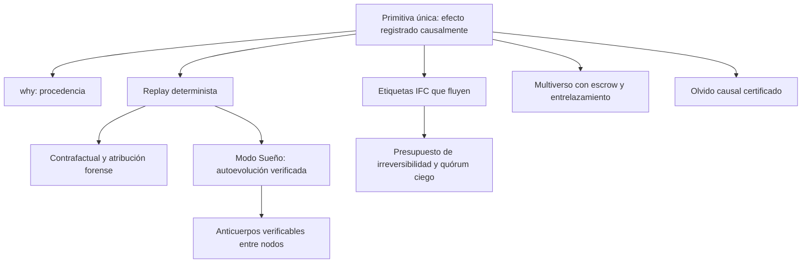

# AgentOS — Lluvia de ideas (sesión 1, 2026-10-11)

> **Regla de la sesión:** vale cualquier idea, por loca que sea. Después le aplicamos el filtro de rigor: qué existe ya, qué sería nuevo y qué se puede probar.
> Las estimaciones de novedad son **mías y sin verificar**. "No lo encontré" no significa "no existe".
> Etiquetas de referencias: **[C]** clásico, **[B]** encontrado en búsqueda con datos concretos, **[P]** pendiente de verificar (igual que en `docs/MASTER_PLAN.md`).

---

## 0. El hallazgo que cambia el plan

Las búsquedas de hoy muestran que **casi cada pieza ya existe por separado**, en general como middleware sobre Linux:

| Pieza | Quién la hace | Ref. |
| :--- | :--- | :--- |
| Control de flujo de información (IFC) contra la inyección de prompt | FIDES (Microsoft Research, 2025); CaMeL (2025) | [B] |
| Fork / explore / commit para agentes | BranchFS + `branch()` (arXiv 2602.08199) | [B] |
| *Commit barriers* y *escrow* para acciones irreversibles | Varios trabajos y guías de 2025–2026; OWASP Agentic Top 10 (2026) | [P] |
| Replay y contrafactuales sobre trayectorias de agentes | RECAST (2026), NeuroTaint | [P] |
| Políticas del SO escritas por LLM | SchedCP, ADRS (Berkeley, 2025) sobre `sched_ext` | [P] |
| Fork copy-on-write de la caché KV | ForkKV (2026); vLLM, SGLang | [P] / [C] |
| Record/replay y procedencia de **todo** el sistema | Arnold, *eidetic systems* (OSDI 2014); PASS (ATC 2006) | [C] |
| Especulación con dependencias entre procesos | Speculator (SOSP 2005); TxOS (SOSP 2009) | [C] |
| IFC en el kernel | HiStar (OSDI 2006); Asbestos (SOSP 2005); Flume (SOSP 2007) | [C] |
| Kernels "agentic-native" en Rust | Veda OS, Zenith OS, KAIROS-ARK (aficionados) | [P] |

**Conclusión:** no gana quien agregue una pieza más. Gana quien encuentre **la primitiva correcta que hace que todas esas propiedades salgan juntas, por construcción, para todo el sistema**. Esa es la tesis de la sección 2.

---

## 1. Todas las ideas (incluidas las locas)

Escala de 1 a 5. **Nov** = novedad estimada · **Fact** = factibilidad para nosotros · **Valor** = impacto si funciona.

| # | Idea | Qué es | Antecedente más cercano | Nov | Fact | Valor |
| :--- | :--- | :--- | :--- | :---: | :---: | :---: |
| 1 | **Libro mayor causal** | Toda interacción entre dominios es un *efecto* registrado con quién, capacidad, causas, etiquetas y reversibilidad. | Arnold, PASS, auditd | 3 | 4 | 5 |
| 2 | **`why(efecto)`** | Syscall que devuelve la cadena causal de cualquier acción. | Grafos de procedencia (PASS, CamFlow) | 3 | 4 | 5 |
| 3 | **IFC en el kernel para agentes** | Etiquetas de integridad y confidencialidad que fluyen entre agentes, servicios y la IA. | HiStar/Flume (sin agentes); FIDES (sin kernel) | 3 | 3 | 5 |
| 4 | **Multiverso con escrow** | Ramas CoW de dominios; los efectos externos quedan retenidos hasta el commit. | Fork-Explore-Commit, TxOS | 3 | 3 | 4 |
| 5 | **Entrelazamiento de ramas** | Si un agente en la rama *k* le escribe a otro, el otro se bifurca dentro de la rama *k*; commit y abort se propagan. | Speculator (seguimiento de dependencias) | **4** | 3 | 4 |
| 6 | **Contrafactual como syscall** | `counterfactual(efecto, parche)`: re-ejecuta el sistema con una entrada modificada o eliminada. | RECAST (sobre trayectorias, no sobre el SO) | **4** | 3 | 5 |
| 7 | **Atribución forense automática** | Usar #6 para demostrar qué entrada causó una acción peligrosa (forense de inyección de prompt). | Causal tracing en ML | **4** | 3 | 5 |
| 8 | **Presupuesto de irreversibilidad** | La irreversibilidad como recurso contable del SO, igual que la CPU o la memoria. | *Commit barriers* (sin contabilidad) | **4** | 4 | 4 |
| 9 | **Quórum ciego** | Las acciones irreversibles requieren *k de n* verificadores heterogéneos que **solo ven el plan estructurado**, nunca el texto no confiable. | Regla de dos personas; *N-version programming* | **4** | 4 | 4 |
| 10 | **Modo Sueño** | En reposo, el SO re-ejecuta **su propia historia real** en universos aislados para probar políticas propuestas por IA. Solo promueve si un verificador aprueba y nada empeora; con rollback. | SchedCP/ADRS (con benchmarks, no con la historia propia) | **4** | 2 | 5 |
| 11 | **IA como dispositivo no determinista** | Las salidas del LLM se registran como si fueran interrupciones. Eso hace reproducible todo el sistema aunque la GPU no lo sea. | Record/replay de dispositivos (ReVirt) | 3 | 5 | 4 |
| 12 | **Olvido causal certificado** | `forget(x)` se propaga por el grafo de procedencia: embeddings, resúmenes, memorias y caché KV derivados. Emite un certificado (Merkle). | PASS; *machine unlearning* | **4** | 3 | 4 |
| 13 | **Anticuerpos verificables** | Un nodo que detecta un ataque comparte una regla firmada. Los demás la aceptan solo si **re-ejecutan su propia historia** y comprueban que la regla bloquea el ataque sin romper nada. | Firmas de antivirus (sin verificación local) | **4** | 2 | 4 |
| 14 | **Anticuerpos con ZKP** | Probar que "esta regla no bloquea nada legítimo de mi historia" **sin revelar la historia**. | zkML / atestaciones | **5** | 1 | 3 |
| 15 | **Libro mayor firmado con PQC** | Las cabeceras del libro mayor se firman con ML-DSA, para auditorías que deban seguir siendo válidas durante décadas. | Logs transparentes (Certificate Transparency) | 2 | 4 | 3 |
| 16 | **Contexto como objeto del kernel** | La caché KV como objeto de memoria con capacidades. El fork de un agente hace copy-on-write de su contexto. | vLLM, ForkKV | 3 | 2 | 3 |
| 17 | **Syscalls con plan** | El agente entrega un plan (un grafo de invocaciones). El sistema lo verifica entero *antes* de ejecutarlo, y el scheduler gana visión del futuro. | CaMeL (planes a nivel de app) | 3 | 3 | 4 |
| 18 | **Capacidades atadas a objetivos** | Al terminar o abandonar el objetivo se revoca todo lo derivado de él. | Macaroons, árbol de derivación de seL4 | 2 | 4 | 3 |
| 19 | **Mercado interno de recursos** | Los agentes "pujan" por CPU y tokens. | Lottery scheduling, Spawn (1992) | 1 | 4 | 2 |
| 20 | **Monitores de lógica temporal** | Los contratos de cada agente se expresan en LTL y se verifican en vivo sobre el libro mayor. | *Runtime verification* | 2 | 3 | 3 |
| 21 | **Aleatorizar nombres de herramientas** | Que la inyección no sepa cómo se llama `send_email`. | ISR (CCS 2003) | 2 | 4 | 1 |
| 22 | **Simulación cuántica como carga de prueba** | Usar simuladores de circuitos como carga heterogénea para probar el scheduler. | — | 1 | 4 | 1 |

### Ideas descartadas y por qué
- **#21:** el LLM necesita conocer los nombres de las herramientas, así que el texto inyectado en el mismo contexto también puede conocerlos. Da una falsa sensación de seguridad.
- **#19:** está muy estudiado y no resuelve un problema específico de los agentes.
- **#22:** es honesto decirlo: no aporta a la tesis. La computación cuántica queda como aplicación.
- **"LLM dentro del kernel":** descartado (ADR-0003).
- **"Sistema de archivos solo semántico, sin rutas":** quita lo que funciona sin dar garantías a cambio. La memoria semántica se **suma**, no reemplaza.

---

## 2. La tesis que une todo: **el Kernel Causal**

> En Unix, todo es un archivo. **En AgentOS, todo es un efecto con causa.**

Las ideas 1 a 13 no son 13 proyectos distintos. Son **consecuencias de una sola decisión de diseño**:

> **Cada dominio (agente o servicio) es una máquina de estados determinista alimentada por mensajes. Toda entrada que recibe pasa por el kernel como un efecto registrado causalmente.**

### Por qué esto justifica, por fin, construir un kernel propio
En Linux, registrar y reproducir **todo** es enormemente difícil: memoria compartida, `mmap`, señales, cientos de syscalls, hilos con carreras. Arnold (OSDI 2014) tuvo que pelear contra todo eso.

En un microkernel donde **toda** interacción entre dominios es un mensaje mediado por capacidades, y donde cada dominio es monohilo por defecto (modelo de actores), las entradas de un dominio son exactamente sus mensajes recibidos. **El replay, la causalidad y las etiquetas salen por construcción.**

Es el argumento técnico más fuerte que encontramos hasta ahora para no construir sobre Linux.

---

## 3. Preguntas incómodas (para no engañarnos)

| Problema | Por qué duele | Camino a investigar |
| :--- | :--- | :--- |
| **Contaminación total de etiquetas** (*label creep*) | En IFC por proceso, todo termina marcado como "no confiable". | El kernel da causalidad gruesa pero infalsificable; el runtime la refina con variables etiquetadas (estilo CaMeL/FIDES). |
| **La IA no es determinista** | La GPU no reproduce los resultados bit a bit. | Idea #11: se registra la salida, no se recalcula. El contrafactual vuelve a consultar el modelo y lo declara. |
| **El libro mayor crece sin fin** | Disco infinito no hay. | Checkpoints y compactación, como el WAL de una base de datos. |
| **Multihilo** | El replay con hilos que comparten memoria requiere registrar el orden de ejecución. | Monohilo por dominio; el paralelismo sale de tener muchos dominios. |
| **Sobrecarga** | Registrar cada mensaje cuesta. | Medir (H7). Si cuesta demasiado, registro por niveles. |
| **Efectos realmente irreversibles** | Un mensaje enviado por la red no se des-envía. | Escrow + presupuesto + quórum. Lo irreversible se vuelve explícito y caro. |
| **¿Sigue siendo un sistema operativo general?** | Un modelo de actores estricto limita a las aplicaciones tradicionales. | Puede convivir un modo "no registrado" para dominios sin garantías, siempre explícito y marcado. |

---

## 4. La demo que demostraría la tesis

1. Tres agentes. Uno lee un email con una inyección de prompt que intenta exfiltrar un archivo.
2. **Etiquetas:** el envío se bloquea, porque una entrada de integridad baja quiere producir una acción externa.
3. **`why()`:** muestra la cadena email → lector → planificador → intento de envío.
4. **`counterfactual()`:** elimina el email, re-ejecuta, y la acción desaparece. La atribución queda demostrada.
5. **Modo Sueño:** propone una regla nueva, la prueba sobre la historia real y la promueve sin regresiones.
6. **Comparación** contra Linux + AIOS / FIDES: tasa de ataques contenidos, costo por efecto, tiempo de atribución y falsos positivos.

---

## 5. Cómo empezar a "flashear" en serio sin esperar dos años

**Pista R (investigación en paralelo al kernel):** el corazón de la tesis se escribe como crates `no_std` y se prueba **ya** en Windows, con un simulador de dominios.

| Hito | Qué se construye | Prueba de aceptación |
| :--- | :--- | :--- |
| **R1** | `causal-ledger` + simulador de dominios deterministas | Re-ejecutar el registro reproduce exactamente el mismo estado final (hash idéntico). |
| **R2** | Etiquetas + `why()` | Una acción derivada de una entrada no confiable queda etiquetada; `why()` devuelve la cadena correcta. |
| **R3** | Multiverso con escrow y entrelazamiento | Abortar una rama no deja efectos visibles; las ramas entrelazadas se confirman o descartan juntas. |
| **R4** | IA como dispositivo (Ollama en tu RTX 3060) + contrafactual | El escenario de la demo se atribuye correctamente en al menos *N* casos sobre un conjunto de ataques definido de antemano. |
| **R5** | Modo Sueño de juguete (políticas de scheduler) | Una política promovida no empeora ninguna métrica sobre la historia registrada. |

> [!IMPORTANT]
> El simulador **no es evidencia de que el kernel funcione**. Sirve para validar y medir las ideas antes de invertir años. El mismo código `no_std` se enlaza después al kernel en la Fase 3: la investigación se convierte en código del kernel.
